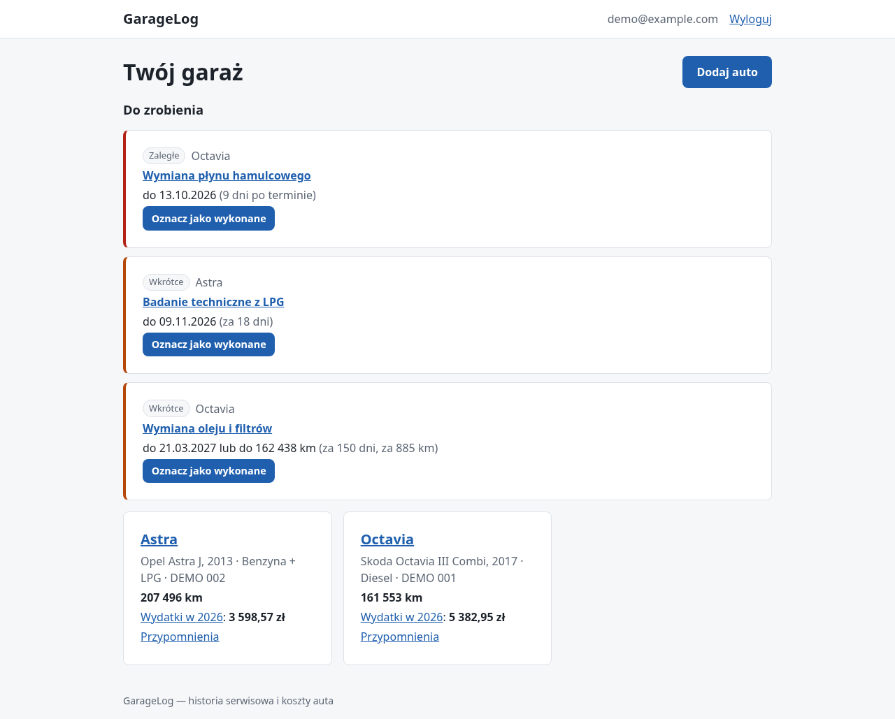
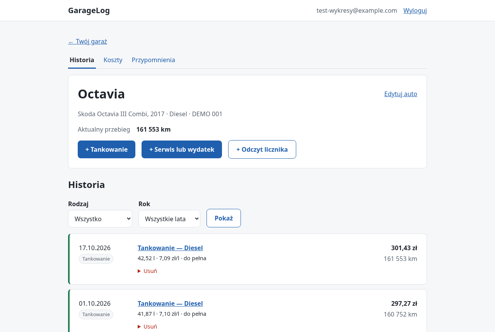
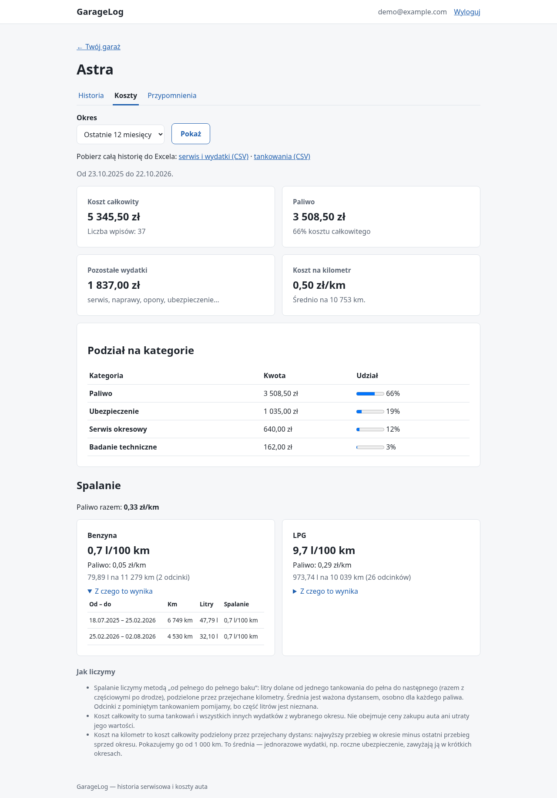
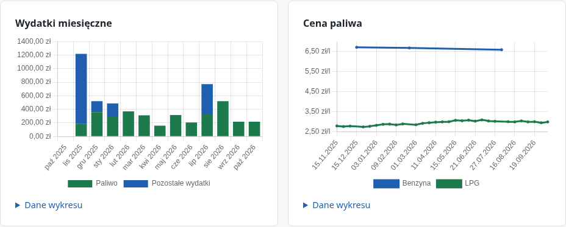
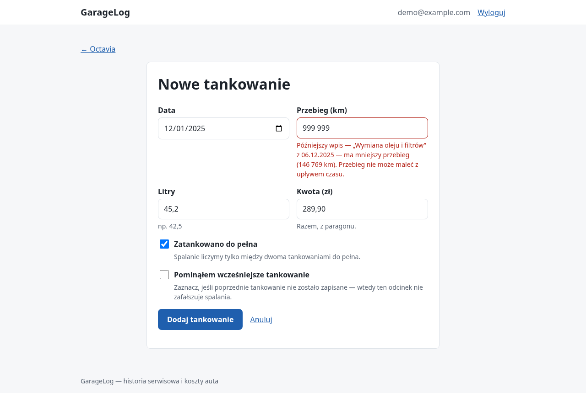
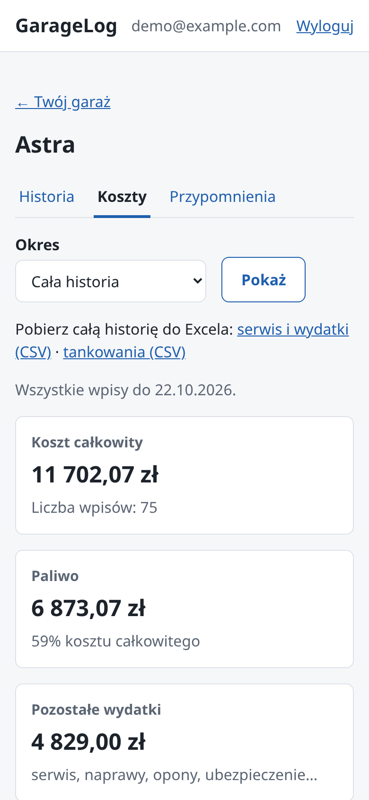
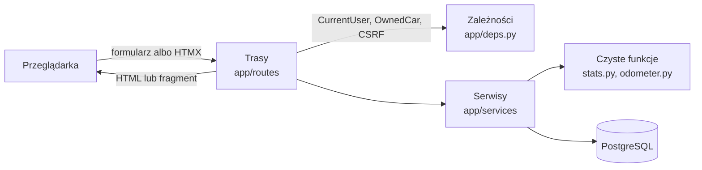

# GarageLog

[](https://github.com/PSkrzyp11/GarageLog/actions/workflows/ci.yml)

Aplikacja webowa do prowadzenia historii serwisowej samochodów i analizowania kosztów ich
utrzymania: tankowania, naprawy, przeglądy, koszt na kilometr, spalanie (także z LPG)
i przypomnienia o terminach.

Projekt portfolio: mały, kompletny monolit w Pythonie, w którym każdą decyzję da się
uzasadnić — od modelu danych po kontrolę dostępu.



| Historia auta | Koszty i spalanie (benzyna + LPG) |
|---|---|
|  |  |
| **Wykresy** | **Walidacja przebiegu** |
|  |  |
| **Telefon (390 px)** | |
|  | |

## Co potrafi

- **Konta** — rejestracja i logowanie, zmiana hasła, wylogowanie innych urządzeń; każdy
  widzi wyłącznie swoje auta i dane.
- **Auta** — kilka aut na konto, paliwo główne + opcjonalna instalacja LPG; sprzedane auto
  trafia do archiwum: znika z pulpitu, a jego historia zostaje tylko do odczytu.
- **Historia** — tankowania (pełne / częściowe / po pominiętym tankowaniu), serwis i inne
  wydatki, odczyty licznika; wspólna oś czasu z filtrem rodzaju i roku oraz wyszukiwarką
  (np. „klocki”, „OC”), która ignoruje wielkość liter i polskie znaki.
- **Paragony i faktury** — do tankowania paragon, do wpisu serwisowego faktura albo polisa:
  zdjęcie (także prosto z aparatu telefonu) lub PDF; ze zdjęcia usuwana jest lokalizacja
  i inne metadane.
- **Spójny przebieg** — wpisy można dopisywać w dowolnej kolejności (stare faktury), ale
  przebieg nie może maleć z upływem czasu; komunikat wskazuje konfliktowy wpis.
- **Koszty** — koszt całkowity, paliwo, podział na kategorie i koszt na kilometr za wybrany
  okres; zamiast mylących liczb — „za mało danych” z wyjaśnieniem.
- **Rok po roku** — kolejne lata obok siebie: wydatki i ich zmiana, średnio na miesiąc,
  dystans, koszt na km, spalanie i największy wydatek poza paliwem.
- **Spalanie** — metodą „od pełnego do pełnego baku”, osobno dla każdego paliwa, z tabelą
  odcinków, z których wynika.
- **Wykresy** — wydatki miesięczne (paliwo i pozostałe), cena paliwa i spalanie w czasie
  (każdy odcinek od pełnego do pełnego baku), z tabelą danych obok każdego wykresu.
- **Przypomnienia** — według daty, przebiegu albo obu („co nastąpi wcześniej”), także
  cykliczne (np. olej co rok lub 15 000 km), z sekcją „Do zrobienia” na pulpicie; terminy
  można pobrać jako plik `.ics` do Kalendarza Google, Apple albo Outlooka.
- **Eksport i import CSV** — pod polskiego Excela, odporny na CSV injection; wyeksportowane
  pliki (także poprawione w Excelu) można wczytać do innego auta lub konta — wszystko albo
  nic, bez dublowania wpisów, które już są.
- **Kopie zapasowe** — kopia bazy codziennie i jedno polecenie do przywrócenia.
- **Interfejs** — po polsku, responsywny, działa bez JavaScriptu; HTMX usprawnia filtry
  i akcje w miejscu.
- **Na telefonie** — można dodać do ekranu głównego jak aplikację; „+ Tankowanie” na
  pulpicie otwiera formularz z dzisiejszą datą, paliwem z ostatniego tankowania i ostatnim
  przebiegiem jako podpowiedzią.

## Stack

| | |
|---|---|
| Backend | Python 3.12+, FastAPI (endpointy synchroniczne), Pydantic |
| Baza | PostgreSQL 18, SQLAlchemy 2.0, Alembic |
| Interfejs | Jinja2 (renderowanie na serwerze), własny CSS, HTMX 2, Chart.js 4 |
| Bezpieczeństwo | Argon2id, sesje w bazie, CSRF, CSP |
| Jakość | pytest (testy na prawdziwym PostgreSQL), ruff, GitHub Actions |
| Uruchamianie | Docker Compose, uv |

Celowo **bez** SPA, mikroserwisów, kolejek i zewnętrznych usług — patrz
[decyzje projektowe](docs/decisions/README.md).

## Szybki start (Docker)

```bash
cp .env.example .env
docker compose up --build -d
docker compose exec app python -m scripts.seed_demo
```

Ostatnie polecenie tworzy konto `demo@example.com` z dwoma autami i około dwuletnią,
fikcyjną historią, a hasło wypisuje raz w konsoli (nie jest nigdzie zapisywane). Własne
hasło: `docker compose exec -e DEMO_PASSWORD=... app python -m scripts.seed_demo --reset`.

Aplikacja: <http://127.0.0.1:8000>. Kontener sam wykonuje migracje przy starcie.

Na publiczny serwer: [deploy/](deploy/README.md) — ta sama aplikacja za Caddy (HTTPS
z Let's Encrypt), w trybie produkcyjnym, z możliwością zamknięcia rejestracji.

## Kopie zapasowe

`docker compose up` uruchamia też kontener `backup`: przy starcie i potem co 24 godziny
zapisuje kopię bazy (`pg_dump`) do folderu `backups/`, a kopie starsze niż 30 dni usuwa —
dopiero po udanej nowej kopii. Folder, odstęp i czas przechowywania ustawia się w `.env`
(`BACKUP_DIR`, `BACKUP_INTERVAL_HOURS`, `BACKUP_KEEP_DAYS`). Najlepiej wskazać folder
synchronizowany z chmurą: kopia na tym samym dysku nie chroni przed jego awarią.

```bash
docker compose run --rm backup once        # kopia teraz

# Przywrócenie: cała baza zostaje zastąpiona kopią (w jednej transakcji — przy błędzie
# nic się nie zmienia). Aplikacja na ten czas jest zatrzymana.
docker compose stop app
docker compose run --rm backup restore garagelog-2026-10-22_210000.dump
docker compose start app
```

## Development

Wymaga [uv](https://docs.astral.sh/uv/) i Dockera (dla PostgreSQL).

```bash
uv sync
docker compose up -d db
uv run alembic upgrade head
uv run uvicorn app.main:create_app --factory --reload
```

Migracje:

```bash
uv run alembic revision --autogenerate -m "opis zmiany"   # po zmianie app/models.py
uv run alembic upgrade head
uv run alembic check                                     # czy modele zgadzają się z migracjami
```

Testy i jakość kodu:

```bash
uv run ruff check .
uv run ruff format --check .
uv run pytest
```

Testy integracyjne tworzą przy każdym uruchomieniu osobną bazę `garagelog_test`, migrują ją
Alembikiem, a każdy test działa w wycofywanej transakcji
([ADR 0006](docs/decisions/0006-tests-on-real-postgres.md)).

## Jak to działa



- **Trasy** obsługują HTTP i decydują o commicie; **serwisy** zawierają reguły wymagające
  bazy; **czyste funkcje** (koszty, spalanie, statusy, spójność przebiegu) nie dotykają bazy
  i są testowane jednostkowo.
- Kontrola dostępu jest częścią zapytania: `WHERE cars.id = :id AND cars.user_id = :user`.
  Cudze i nieistniejące zasoby dają to samo 404.
- Nic nie jest liczone „z góry”: aktualny przebieg, sumy i statusy przypomnień powstają przy
  odczycie, więc edycja wpisu nie może zostawić nieaktualnych danych.

Więcej: [architektura, droga żądania i model danych](docs/architecture.md).

## Definicje obliczeń

| Wartość | Definicja |
|---|---|
| Koszt całkowity | Suma tankowań i pozostałych wydatków z okresu. Bez ceny zakupu i utraty wartości. |
| Koszt na kilometr | Koszt całkowity ÷ przejechany dystans (najwyższy przebieg w okresie minus ostatni sprzed okresu). Pokazywany od 1 000 km. |
| Spalanie | Σ litrów ÷ Σ km z odcinków między tankowaniami do pełna tego samego paliwa; odcinki z pominiętym tankowaniem są pomijane ([ADR 0004](docs/decisions/0004-full-to-full-consumption.md)). |
| Koszt paliwa na km | Koszt tankowań w tych samych odcinkach ÷ ich dystans; dla auta z LPG suma obu paliw. |
| Przypomnienie zaległe | Minęła data albo przebieg osiągnął wartość docelową — co nastąpi wcześniej. „Wkrótce”: do 30 dni lub 1 000 km. |

Kwoty są liczone na `Decimal` i zapisywane jako `NUMERIC` ([ADR 0005](docs/decisions/0005-money-as-numeric.md)).

## Bezpieczeństwo

- Hasła: Argon2id; nieudane logowanie nie zdradza, czy konto istnieje (także czasem odpowiedzi).
  Po 5 nieudanych próbach na jeden e-mail albo 20 z jednego adresu IP logowanie jest
  wstrzymane na 15 minut (liczone w bazie, także dla nieistniejących kont).
  Zmiana hasła wymaga obecnego hasła i wylogowuje pozostałe urządzenia.
- Sesje w bazie: w ciasteczku (`HttpOnly`, `SameSite=Lax`, `Secure` w produkcji) losowy token,
  w bazie tylko jego skrót SHA-256; nowy token przy każdym logowaniu
  ([ADR 0002](docs/decisions/0002-server-side-sessions.md)).
- CSRF: podpisany token powiązany z sesją, sprawdzany dla **każdego** żądania zmieniającego dane.
- Kontrola dostępu przetestowana dla każdej trasy z `{car_id}`; test kontrolny nie pozwala dodać
  trasy bez tego testu.
- Nagłówki: Content-Security-Policy (`default-src 'self'`, bez skryptów inline),
  `X-Frame-Options`, `nosniff`, `Referrer-Policy`, `Permissions-Policy`.
- Limit 64 KB na treść żądania: formularz jest czytany (sprawdzenie CSRF), zanim wiadomo,
  kto go wysłał, a ani uvicorn, ani Starlette nie ograniczają jego rozmiaru.
- Eksport CSV: tekst zaczynający się od `=`, `+`, `-`, `@` nie stanie się formułą w Excelu.
- Paragony: typ rozpoznawany po zawartości, zdjęcia zapisywane od nowa bez metadanych (GPS),
  PDF tylko do pobrania, do 10 MB ([ADR 0009](docs/decisions/0009-receipts-in-database.md)).
- Zależności: Dependabot proponuje aktualizacje raz w miesiącu; akcje GitHub w CI są
  przypięte do SHA commitów, nie do tagów, które można przesunąć.
- Sekrety tylko w zmiennych środowiskowych (`.env` poza repozytorium); w produkcji aplikacja
  nie wystartuje z domyślnym `SECRET_KEY`.

## Interfejs

Strony są renderowane na serwerze i działają bez JavaScriptu. [HTMX](https://htmx.org) 2.0.11
tylko je usprawnia ([ADR 0001](docs/decisions/0001-ssr-with-htmx.md)). Wykresy na stronie kosztów
rysuje [Chart.js](https://www.chartjs.org) 4.5.1 z danych policzonych na serwerze
([ADR 0007](docs/decisions/0007-charts-with-chartjs.md)); bez JavaScriptu zostaje tabela z tymi
samymi liczbami.

Obie biblioteki są w repozytorium (`app/static/js/`) i serwowane z naszej domeny, więc
Content-Security-Policy nie dopuszcza żadnych zewnętrznych skryptów:

| Plik | Źródło | SHA-256 |
|---|---|---|
| `htmx.min.js` | npm `htmx.org@2.0.11` | `d6fdc75f…4000f717` |
| `chart.umd.min.js` | npm `chart.js@4.5.1` | `48444a82…05c9f54a` |

Manifest (`/manifest.webmanifest`) i ikony pozwalają dodać GarageLog do ekranu głównego
telefonu (Android: „Zainstaluj aplikację”, iPhone: „Udostępnij → Do ekranu początkowego”);
przeglądarka wymaga do tego HTTPS — patrz [deploy/](deploy/README.md). Celowo bez service
workera: nie trzyma kopii stron z danymi na telefonie, a bez serwera aplikacja i tak nie
działa.

Pliki statyczne mają w adresie skrót zawartości (`app.css?v=…`), więc przeglądarka może je
trzymać przez rok bez ryzyka nieaktualnego stylu.

## Ograniczenia

Świadomie poza zakresem albo uproszczone:

- jedna waluta (PLN) i jednostki metryczne;
- brak aut elektrycznych i ładowania;
- wymiana licznika (cofnięcie przebiegu) nie jest obsługiwana;
- przypomnienia tylko w aplikacji — bez e-maili;
- brak resetu hasła, weryfikacji e-maila i usuwania konta z poziomu aplikacji;
- formularz rejestracji zdradza, że e-mail jest już zajęty (bez potwierdzania e-maila nie da
  się tego uniknąć — formularz logowania niczego nie zdradza);
- dwa jednoczesne zapisy z dwóch kart przeglądarki nie są blokowane (reguła przebiegu może
  wtedy przepuścić konflikt);
- koszt nie obejmuje ceny zakupu ani utraty wartości auta;
- domyślnie aplikacja lokalna (Docker Compose); do serwera jest gotowy wzór w `deploy/`,
  ale publiczne demo nie jest wdrożone.

## Możliwe dalsze kroki

Subskrypcja kalendarza (zamiast pobierania pliku), reset hasła.

## Licencja

[MIT](LICENSE)
