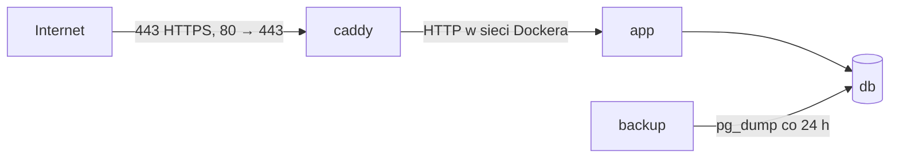

# Wdrożenie na serwer

Wzór uruchomienia GarageLog na publicznym serwerze z Dockerem: aplikacja, PostgreSQL, kopie
zapasowe i [Caddy](https://caddyserver.com), który sam załatwia certyfikat HTTPS
(Let's Encrypt) i przekierowanie z `http://` na `https://`.



Z zewnątrz widać tylko Caddy. Aplikacja i baza nie mają otwartych portów.

## Czego potrzeba

- serwer z Linuksem, Dockerem i Docker Compose v2, z otwartymi portami 80 i 443;
- domena albo subdomena (np. `garagelog.domena-kolegi.pl`) z rekordem DNS **A**
  (i **AAAA** przy IPv6) wskazującym na serwer — Let's Encrypt sprawdza go przy wydawaniu
  certyfikatu;
- jeśli na serwerze działa już nginx, Traefik albo inny serwer na portach 80/443 — patrz
  [Serwer z istniejącym reverse proxy](#serwer-z-istniejącym-reverse-proxy).

## Pierwsze uruchomienie

```bash
git clone https://github.com/PSkrzyp11/GarageLog.git
cd GarageLog/deploy
cp .env.example .env
python3 -c "import secrets; print(secrets.token_urlsafe(48))"   # → SECRET_KEY
openssl rand -hex 24                                             # → POSTGRES_PASSWORD
nano .env                                                        # DOMAIN, SECRET_KEY, POSTGRES_PASSWORD
docker compose up -d --build
docker compose logs -f caddy app                                 # certyfikat i start aplikacji
```

Potem:

1. Otwórz `https://<DOMAIN>` i załóż swoje konto.
2. W `.env` ustaw `REGISTRATION_OPEN=false` i wykonaj `docker compose up -d` — nikt inny nie
   założy już konta (strona rejestracji zwraca 403, link znika).

## Co jest włączone w produkcji

| | |
|---|---|
| HTTPS | certyfikat i odnawianie: Caddy; aplikacja wysyła `Strict-Transport-Security` |
| Ciasteczka | `Secure`, `HttpOnly`, `SameSite=Lax` |
| Logowanie | po 5 nieudanych próbach na jeden e-mail albo 20 z jednego adresu IP — 15 minut przerwy |
| Rejestracja | do wyłączenia (`REGISTRATION_OPEN=false`) |
| Sekrety | bez wartości domyślnych; aplikacja nie wystartuje z przykładowym `SECRET_KEY` |
| Restart | kontenery wstają same po restarcie serwera (`restart: unless-stopped`) |

## Kopie zapasowe

Kontener `backup` robi kopię bazy przy starcie i co 24 godziny do `deploy/backups/`
(szczegóły w głównym README). Kopia na tym samym serwerze nie chroni przed jego awarią —
pobieraj ją co jakiś czas na własny komputer, np.:

```bash
scp 'uzytkownik@serwer:GarageLog/deploy/backups/*.dump' .
```

## Przeniesienie danych z komputera na serwer

1. Lokalnie: `docker compose run --rm backup once` (kopia trafi do `backups/`).
2. Skopiuj plik do `deploy/backups/` na serwerze (np. `scp`).
3. Na serwerze, gdy aplikacja jest już uruchomiona (migracje utworzyły tabele):

   ```bash
   docker compose stop app
   docker compose run --rm backup restore garagelog-2026-10-23_120000.dump
   docker compose start app
   ```

Kopia musi pochodzić z tej samej wersji aplikacji co serwer (te same migracje).

## Aktualizacja

```bash
cd GarageLog
git pull
cd deploy
docker compose up -d --build
```

Aplikacja przy starcie sama wykonuje migracje bazy. Przed większą aktualizacją warto zrobić
kopię: `docker compose run --rm backup once`.

## Serwer z istniejącym reverse proxy

Jeśli porty 80/443 zajmuje już inny serwer (nginx, Traefik…), Caddy nie jest potrzebny:

1. W `compose.yaml` usuń usługę `caddy` (i wolumeny `caddy-data`, `caddy-config`).
2. Usłudze `app` dodaj port dostępny tylko z tego serwera:

   ```yaml
       ports:
         - "127.0.0.1:8000:8000"
   ```

   `FORWARDED_ALLOW_IPS: "*"` może zostać, bo do portu dociera wtedy tylko lokalny proxy.
3. Skieruj domenę na `http://127.0.0.1:8000`, przekazując adres odwiedzającego i protokół —
   dla nginx:

   ```nginx
   location / {
       proxy_pass http://127.0.0.1:8000;
       proxy_set_header Host $host;
       proxy_set_header X-Forwarded-For $remote_addr;
       proxy_set_header X-Forwarded-Proto $scheme;
   }
   ```

   Bez tych nagłówków limit logowań widziałby wszystkich jako jeden adres, a aplikacja
   budowałaby linki z `http://`.

## Sprawdzenie po wdrożeniu

```bash
curl -s -D - -o /dev/null https://<DOMAIN>/login | grep -iE 'strict-transport|set-cookie'
curl -s https://<DOMAIN>/health
docker compose ps
```
