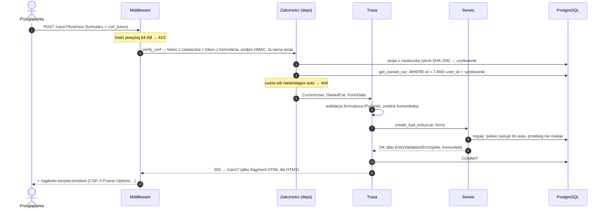
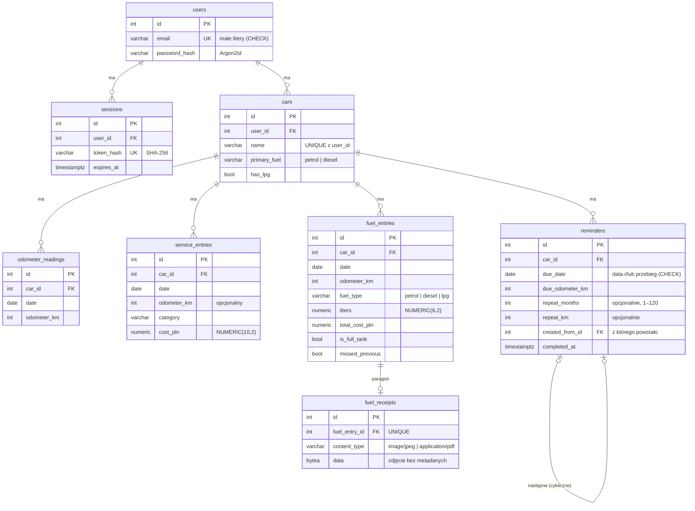
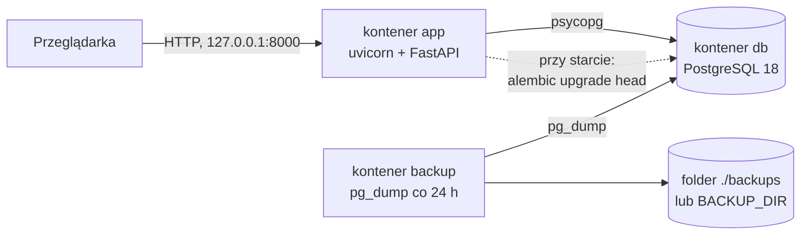

# Architektura

Jedna aplikacja (monolit) i jedna baza. Trzy warstwy, bez osobnej warstwy repozytoriów —
`Session` z SQLAlchemy już nią jest.

| Warstwa | Gdzie | Za co odpowiada |
|---|---|---|
| Trasy | `app/routes/` | HTTP: formularz → walidacja (Pydantic) → serwis → szablon albo przekierowanie; commit transakcji |
| Serwisy | `app/services/` | Reguły wymagające bazy, zapytania SQLAlchemy (zawsze w obrębie auta, którego właściciela już sprawdzono) |
| Czyste funkcje | `app/stats.py`, `app/odometer.py` | Koszty, spalanie, statusy przypomnień, spójność przebiegu — bez bazy, łatwe do testowania |
| Bezpieczeństwo | `app/security.py`, `app/deps.py` | Hasła, sesje, CSRF, nagłówki; `CurrentUser` i `get_owned_car` jako punkt kontroli dostępu |

## Droga żądania

## Model danych

Relacje z rodzicem mają `ON DELETE CASCADE` w bazie: usunięcie auta usuwa jego historię,
usunięcie konta — wszystko. Wyjątek to `reminders.created_from_id` (`SET NULL`): usunięcie
starego przypomnienia nie usuwa następnego ([ADR 0008](decisions/0008-recurring-reminders.md)). Nie ma kolumn z sumami ani aktualnym przebiegiem: wszystkie
podsumowania są liczone przy odczycie ([ADR 0003](decisions/0003-derived-odometer.md)).

## Uruchamianie

`docker compose up` uruchamia wszystkie kontenery; aplikacja startuje dopiero, gdy baza
zgłosi gotowość, i przed startem wykonuje migracje. Porty są dostępne tylko z `127.0.0.1`.
Kontener `backup` robi kopię bazy przy starcie i potem co 24 godziny
(`scripts/backup.sh`); szczegóły w README.

Na publicznym serwerze ([deploy/](../deploy/README.md)) przed aplikacją stoi Caddy:
kończy HTTPS i przekazuje adres odwiedzającego w `X-Forwarded-For`, a aplikacja i baza
nie mają otwartych portów.
